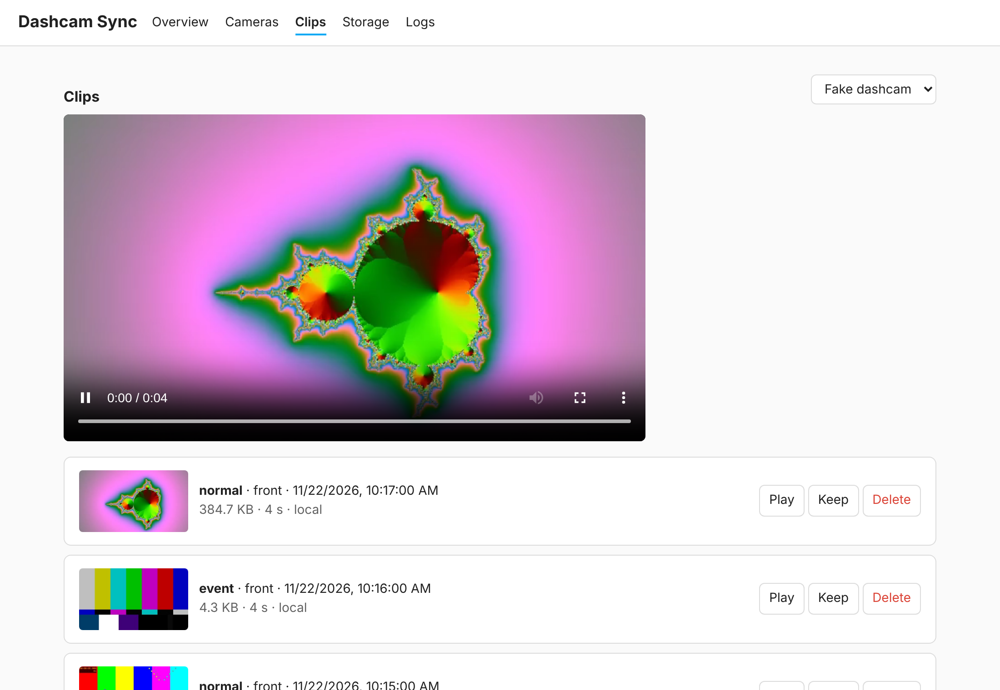
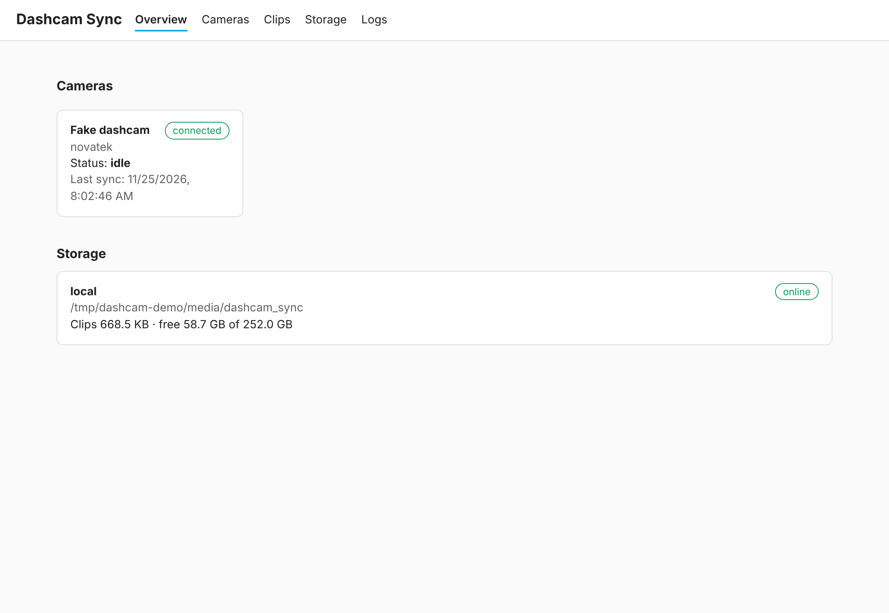
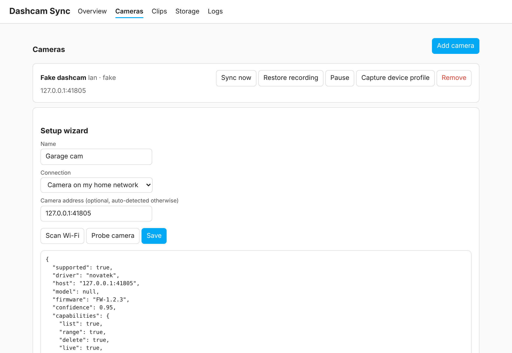
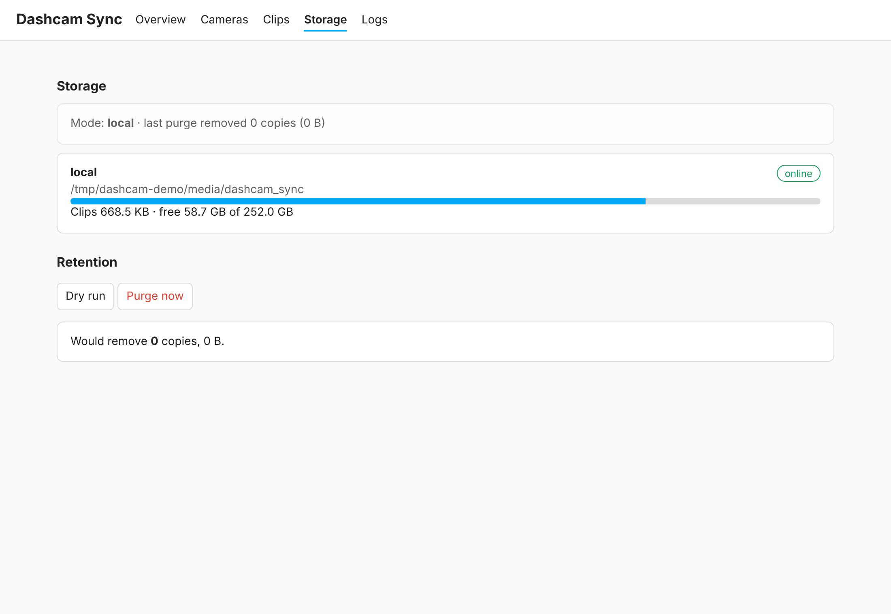
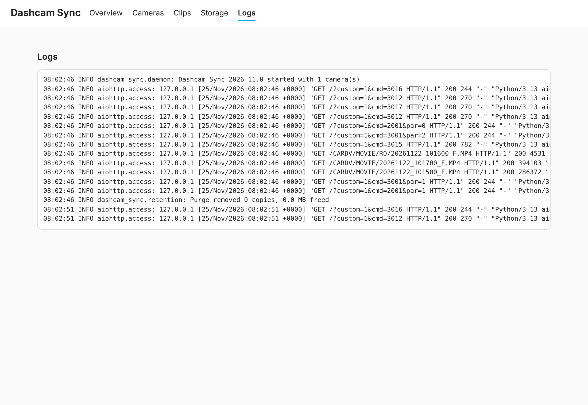
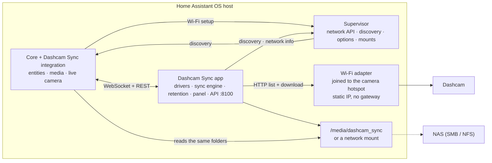

<p align="center">
  
</p>

<h1 align="center">Dashcam Sync for Home Assistant</h1>

<p align="center">
  Pull the clips off a Wi-Fi dashcam into Home Assistant whenever the car is in range.<br>
  No phone app. No cloud. Event clips first, and the camera is <em>always</em> put back into recording.
</p>

<p align="center">
  <a href="https://github.com/adamstoffel/ha-dashcam-sync/actions/workflows/ci.yml"></a>
  <a href="LICENSE"></a>
  
  
  
  
</p>

<p align="center">
  
</p>

## Contents

[What you get](#what-you-get) · [Install](#install) · [A quick tour](#a-quick-tour) · [How it fits together](#how-it-fits-together) · [Supported cameras](#supported-cameras) · [Quality and testing](#quality-and-testing) · [What has and has not been verified](#what-has-and-has-not-been-verified) · [Documentation](#documentation) · [Contributing](#contributing)

## What you get

- **Clips in Home Assistant, automatically.** The app finds the camera when the car arrives, pulls event clips first, then parking and the most recent normal clips, and stores them under `/media`, on your NAS, or both.
- **Safe on the road.** The camera is put back into recording after every session, error, crash or power loss. Interrupted downloads resume without being fetched twice; every file is size-checked and hashed.
- **Safe on your network.** Many cameras use 192.168.1.x, which your home network probably uses too. Home Assistant claims only a block of four addresses around the camera, and a pre-flight check refuses to connect if anything would collide.
- **The Home Assistant way.** A config flow with Supervisor discovery, a device per camera, translated entities, an event entity for every new clip, a live camera, a media-browser library, actions, diagnostics, repair issues with fix flows and a notification blueprint.
- **Community drivers.** Novatek, Viidure and plain-HTTP cameras today; a documented driver framework, a one-click device-profile capture and fixture replay in CI for everything else.
- **Private by design.** Local only, no telemetry, an app security rating of 8 (no host network, no extra capabilities, default API role, ingress, custom AppArmor).

It ships as two pieces that are tested together and released together:

| Piece | What it does | Where it goes |
| --- | --- | --- |
| **App** (`app/`) | Finds the camera, detects its API family, downloads clips (resumable, verified), restores recording, stores and expires clips, serves a panel and a local API. | An App repository you add under **Settings › Apps › App store › Repositories**. Images on GHCR, signed with Cosign. |
| **Integration** (`integration/`) | Turns the app into devices, entities, a live camera and a clip library. Joins the camera's hotspot through the Supervisor. | The Marketplace (or HACS) as `dashcam_sync`. |

The split is forced by distribution: the Marketplace lists integrations, cards, themes and templates, not apps.

> **Status: pre-release (`stage: experimental`).** Built and tested end to end against a fake camera; **no real dashcam has been tested yet**. See [What has and has not been verified](#what-has-and-has-not-been-verified) before you rely on it.

## Install

[](https://my.home-assistant.io/redirect/supervisor_add_addon_repository/?repository_url=https%3A%2F%2Fgithub.com%2Fadamstoffel%2Fha-dashcam-sync)
[](https://my.home-assistant.io/redirect/hacs_repository/?owner=adamstoffel&repository=dashcam-sync-integration&category=integration)

1. **Add the app repository** with the button above (or add `https://github.com/adamstoffel/ha-dashcam-sync` under **Settings › Apps › App store › Repositories**), install **Dashcam Sync** and start it.
2. **Install the integration** with the second button and restart Home Assistant, then confirm the discovered **Dashcam Sync** device.
3. Open **Dashcam Sync** in the sidebar › **Cameras › Add camera**.

Honest expectations: hotspot transfers are slow (often under 1 MB/s) and most mirror-powered cameras turn off with the car, so **event clips are the realistic goal**. Recordings can show other people and plates; everything stays on your hardware. The full walkthrough is in [docs/](docs/index.md) and the app's `DOCS.md`.

## A quick tour

| | |
| --- | --- |
| <br>**Overview**: every camera's state, speed and queue, plus storage health and any repair issues. | <br>**Cameras**: the setup wizard probes the camera, detects its driver and computes the address block. |
| <br>**Storage**: local and network targets, retention, and a dry run that lists exactly what the next purge would delete. | <br>**Logs**: the app's own log, so you can diagnose without leaving Home Assistant. |

## How it fits together



Key design points (all from the build plan):

- **The app asks for almost nothing**: no host network, no extra capabilities, the default API role, ingress for its UI and a custom AppArmor profile, for a security rating of 8. Core, not the app, changes the Wi-Fi adapter.
- **Small-block addressing**: many cameras live on 192.168.1.x, which home networks also use. Home Assistant claims only the smallest block that holds itself and the camera (normally a /30), with no gateway and no DNS, so only four addresses are routed to the car. A pre-flight check blocks the camera with a repair issue instead of connecting and hoping.
- **The camera is always put back into recording**: `restore()` runs from a `finally`, and a flag on disk makes the next contact restore first, even after a crash or power loss.
- **Resumable and verified**: `.part` files with offsets checkpointed every 4 MB, HTTP Range resume (and a restart when a camera ignores Range), size and `Content-Length` checks, SHA-256, atomic moves.
- **Hostile input**: camera responses are capped, XML goes through defusedxml, camera paths are never used as file names, ffmpeg is sandboxed with limits.

## Supported cameras

| Driver | Detected by | Typical default address | Confidence |
| --- | --- | --- | --- |
| `novatek` | `/?custom=1&cmd=3016` heartbeat answers XML | 192.168.1.254 | documented, awaiting hardware |
| `viidure_app` | JSON from `/app/getproductinfo` | 192.168.169.1 | documented, awaiting hardware |
| `http_index` | Any HTML directory listing with video links | any | documented, awaiting hardware |
| `blackvue`, `ait`, `ambarella` | | | planned for 1.1 and 1.2 |

Details and quirks: [docs/supported-cameras.md](docs/supported-cameras.md). Got an unsupported camera? [Capture a device profile](docs/device-profile.md): it is read-only and redacted, and a contributor can write the driver from it.

## How it works, in one paragraph

The app polls for the camera every 15 s (every 3 s for five minutes after an arrival hint such as your car's device tracker coming home). When it is in range the app detects the camera family, writes a restore flag to disk, puts the camera in playback mode, lists the files and queues the new ones: event clips newest first, then parking, then the most recent normal clips. Each file downloads to a `.partial` file with its offset checkpointed every 4 MB, resumes with an HTTP Range request if the link drops, is verified against the listing and `Content-Length`, hashed with SHA-256 and moved into place atomically. Then the camera goes back into recording, the flag is cleared, and a background worker remuxes `.ts` to `.mp4`, makes a thumbnail and writes a sidecar. Retention runs after each sync and daily.

## Quality and testing

Every claim below is enforced in CI on every push.

| Layer | What it proves | Size |
| --- | --- | --- |
| App unit and component tests | Queue order, retention maths, path sanitising, address-block logic, storage health, catalogue, engine state machine | 202 tests, 90 %+ coverage, `ruff`, `mypy --strict` |
| Fault injection | A fake camera that drops connections, stalls, lies about lengths, ignores Range, refuses playback or fails to restore: resume, verify and restore always happen, including when the app is cancelled mid-download | part of the above |
| Property-based fuzzing | Hypothesis tests on the address maths, queue ordering, retention, redaction, local path building and every parser of camera-supplied data (XML, JSON, HTML, mount tables, options) | 13 properties (`DASHCAM_FUZZ=1` runs 3000 examples each nightly) |
| Driver replay | Every recorded device profile is replayed against every driver: each claims its own family and no other | 4 fixtures |
| Integration tests | Config, options, reauth and reconfigure flows, every platform, actions, media source, views, diagnostics, repairs, metadata rules | 108 tests, 95 %+ coverage, `ruff`, `mypy --strict` |
| Real-stack end to end | Fake camera → **real app daemon** → **real integration inside Home Assistant**, nothing mocked in between | 8 tests |
| Browser tests | Playwright drives the panel: clips list, thumbnails decode, video plays, Keep toggles, retention dry run, the wizard detects the driver; fails on any console error or failed request | 1 script, screenshots as artifacts |
| Packaging | Manifest, schema, translations, s6 services, AppArmor, security-rating arithmetic, hashed requirements | in the app tests |
| Pipelines | `hassfest`, hadolint, the Docker image builds and starts, `actionlint`-clean workflows | see [CI](.github/workflows/ci.yml) |

Randomised test order and repeated runs are used to hunt flakiness, and the suites have already caught real bugs that unit tests alone missed (see the changelog).

## Repository layout

```
app/                          -> dashcam-sync-app (App repository)
  repository.yaml
  dashcam_sync/               config.yaml, Dockerfile, apparmor.txt, DOCS.md, translations, s6 services
    src/dashcam_sync/         the daemon: engine, drivers/, storage, retention, api, ui_static/
  tests/                      fake camera, fixtures, property-based tests
integration/                  -> dashcam-sync-integration (Marketplace)
  hacs.json  blueprints/
  custom_components/dashcam_sync/
  tests/
docs/  scripts/  .github/
```

`scripts/split_repos.sh <owner>` produces the two release repositories (`git subtree split`); the per-repository workflows in `app/.github` and `integration/.github` become active after the split. Until then the root workflows cover both.

## Development

See [CONTRIBUTING.md](CONTRIBUTING.md). Quick start without a car:

```bash
python3.13 -m venv .venv-app && . .venv-app/bin/activate
pip install -e "app[dev]"
python scripts/dev.py        # fake camera + daemon: panel on :8099, API on :8100
```

## Decisions on the plan's open questions

| Question | Decision |
| --- | --- |
| Licence | **Apache-2.0** (matches Home Assistant). |
| Supervised installs | Supported on a best-effort basis; anything with the Supervisor works, Home Assistant OS is what gets tested. |
| Two hotspot cameras on one adapter | **No.** One adapter per hotspot camera, permanently (validated: a second camera on the same interface is disabled with a repair issue). LAN cameras are unlimited. |
| Keep `.ts` or only `.mp4` | `.mp4` only by default; `storage.keep_original: true` keeps the `.ts` for evidential use. |

## What has and has not been verified

**Verified (automated, in CI):**

- Everything in the table above, against a fake camera and a fake Supervisor, with real ffmpeg, real HTTP and WebSocket servers, and the real integration running inside Home Assistant **2026.2.3** (the newest release on PyPI when this was built; the integration targets 2026.11).
- `hassfest` passes for the integration; the Docker image builds and starts (`ghcr.io/home-assistant/base-python`, Python 3.13, ffmpeg).

**Not verified** (needs hardware or infrastructure not available during the build; these are the plan's Spike 0 and release gates):

- **Any real camera.** The Novatek, Viidure `/app` and HTTP-index drivers follow published community documentation and captures, not hardware. Details such as Novatek 3032/3033/3018 (station mode) and the Viidure playback and record calls must be confirmed on a camera.
- **Spike 0:** whether an app container can reach a camera on the host's Wi-Fi adapter without `host_network`, whether Supervisor discovery starts a *custom* integration's `async_step_hassio`, and whether Core's Supervisor client is usable from a custom integration (it is wrapped in one module, `wifi.py`, with a manual fallback).
- The AppArmor profile under enforcement (run it in complain mode through the beta).
- The HACS action (it validates the layout of the split `dashcam-sync-integration` repository, so it runs there), Home Assistant 2026.11 itself, Marketplace catalog acceptance, and translations beyond English.

The release workflow refuses a stable tag until `docs/hardware-gate/<version>.md` records a passing hardware matrix, so nothing stable ships without real-camera results.

## Documentation

| | |
| --- | --- |
| [docs/index.md](docs/index.md) | Install walkthrough, Wi-Fi adapter guidance, storage |
| [docs/supported-cameras.md](docs/supported-cameras.md) | Drivers, quirks, confidence levels |
| [docs/api.md](docs/api.md) | The app's local REST and WebSocket API |
| [docs/writing-a-driver.md](docs/writing-a-driver.md) | Add support for a camera family |
| [docs/device-profile.md](docs/device-profile.md) | Capture a redacted profile of an unsupported camera |
| [docs/troubleshooting.md](docs/troubleshooting.md) | Symptoms and fixes |
| [app/dashcam_sync/DOCS.md](app/dashcam_sync/DOCS.md) | The app's *Documentation* tab: every option, retention, the overlapping-address guide |
| [integration/README.md](integration/README.md) | Entities, actions, data updates, known limitations |
| [SECURITY.md](SECURITY.md) | Reporting vulnerabilities (90-day coordinated disclosure) |

## Contributing

The most valuable contribution is **a driver for a camera family that is not supported yet**. Start with [CONTRIBUTING.md](CONTRIBUTING.md); `make help` lists the common tasks, and `python scripts/dev.py --demo` runs the whole app against a fake camera with real video.

## Licence

[Apache-2.0](LICENSE).
