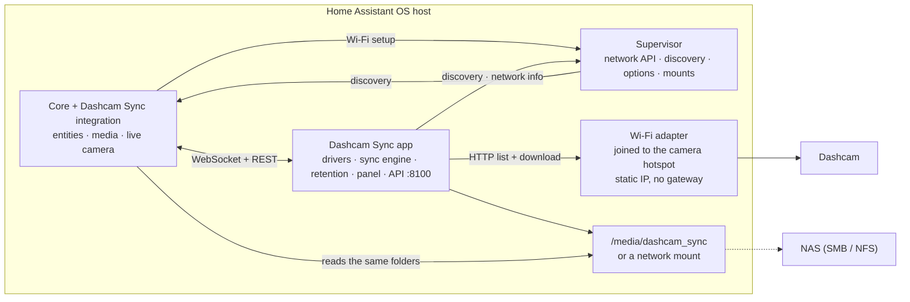

# Dashcam Sync for Home Assistant

Pull the clips off a Wi-Fi dashcam into Home Assistant whenever the car is in range. No phone app, no cloud.

It ships as two pieces that are tested together and released together:

| Piece | What it does | Where it goes |
| --- | --- | --- |
| **App** (`app/`) | Finds the camera, detects its API family, downloads clips (resumable, verified), restores recording, stores and expires clips, serves a panel and a local API. | An App repository you add under **Settings › Apps › App store › Repositories**. Images on GHCR, signed with Cosign. |
| **Integration** (`integration/`) | Turns the app into devices, translated entities, a live camera, a clip library in the media browser, actions, diagnostics and repair issues. Joins the camera's hotspot through the Supervisor. | The Marketplace (or HACS) as `dashcam_sync`. |

The split is forced by distribution: the Marketplace lists integrations, cards, themes and templates, not apps.

> **Status: pre-release (`stage: experimental`).** Everything below is built and tested against a fake camera; nothing has run against real hardware yet. See [What has and has not been verified](#what-has-and-has-not-been-verified).

## Install

1. Add the app repository: <https://my.home-assistant.io/redirect/supervisor_add_addon_repository/?repository_url=https%3A%2F%2Fgithub.com%2Fadamstoffel%2Fha-dashcam-sync> (or add `https://github.com/adamstoffel/ha-dashcam-sync` by hand), install **Dashcam Sync**, start it.
2. Install the integration: <https://my.home-assistant.io/redirect/hacs_repository/?owner=adamstoffel&repository=dashcam-sync-integration&category=integration> and confirm the discovered **Dashcam Sync** device.
3. Open **Dashcam Sync** in the sidebar › **Cameras › Add camera**.

Details, supported cameras and troubleshooting: [docs/](docs/index.md) and the app's `DOCS.md`.

Honest expectations: hotspot transfers are slow (often under 1 MB/s) and most mirror-powered cameras turn off with the car, so **event clips are the realistic goal**. Recordings can show other people and plates; everything stays on your hardware.

## How it fits together



Key design points (all from the build plan):

- **The app asks for almost nothing**: no host network, no extra capabilities, the default API role, ingress for its UI and a custom AppArmor profile, for a security rating of 8. Core, not the app, changes the Wi-Fi adapter.
- **Small-block addressing**: many cameras live on 192.168.1.x, which home networks also use. Home Assistant claims only the smallest block that holds itself and the camera (normally a /30), with no gateway and no DNS, so only four addresses are routed to the car. A pre-flight check blocks the camera with a repair issue instead of connecting and hoping.
- **The camera is always put back into recording**: `restore()` runs from a `finally`, and a flag on disk makes the next contact restore first, even after a crash or power loss.
- **Resumable and verified**: `.part` files with offsets checkpointed every 4 MB, HTTP Range resume (and a restart when a camera ignores Range), size and `Content-Length` checks, SHA-256, atomic moves.
- **Hostile input**: camera responses are capped, XML goes through defusedxml, camera paths are never used as file names, ffmpeg is sandboxed with limits.

## Repository layout

```
app/                          -> dashcam-sync-app (App repository)
  repository.yaml
  dashcam_sync/               config.yaml, Dockerfile, apparmor.txt, DOCS.md, translations, s6 services
    src/dashcam_sync/         the daemon: engine, drivers/, storage, retention, api, ui_static/
  tests/                      fake camera, fixtures, 153 tests
integration/                  -> dashcam-sync-integration (Marketplace)
  hacs.json  blueprints/
  custom_components/dashcam_sync/
  tests/
docs/  scripts/  .github/
```

`scripts/split_repos.sh <owner>` produces the two release repositories (`git subtree split`); the per-repository workflows in `app/.github` and `integration/.github` become active after the split. Until then the root workflows cover both.

## Development

See [CONTRIBUTING.md](CONTRIBUTING.md). Quick start without a car:

```bash
python3.13 -m venv .venv-app && . .venv-app/bin/activate
pip install -e "app[dev]"
python scripts/dev.py        # fake camera + daemon: panel on :8099, API on :8100
```

## Decisions on the plan's open questions

| Question | Decision |
| --- | --- |
| Licence | **Apache-2.0** (matches Home Assistant). |
| Supervised installs | Supported on a best-effort basis; anything with the Supervisor works, Home Assistant OS is what gets tested. |
| Two hotspot cameras on one adapter | **No.** One adapter per hotspot camera, permanently (validated: a second camera on the same interface is disabled with a repair issue). LAN cameras are unlimited. |
| Keep `.ts` or only `.mp4` | `.mp4` only by default; `storage.keep_original: true` keeps the `.ts` for evidential use. |

## What has and has not been verified

Verified here (automated):

- **App**: ruff, `mypy --strict`, 153 tests at 91 % line coverage, against an in-process fake camera with fault injection (dropped connections, ignored Range, wrong lengths, refused playback, failing restore, cancellation mid-download), a replay of recorded device profiles against every driver, real ffmpeg remux/thumbnail runs, a fake Supervisor, real HTTP and WebSocket servers.
- **Integration**: ruff, 104 tests at 98 % coverage with `pytest-homeassistant-custom-component` on **Home Assistant 2026.2.3** (the newest release on PyPI at build time; the integration targets 2026.11).
- **End to end**: `scripts/dev.py` ran the daemon against the fake camera and produced the expected files, sidecars and API output.

**Not verified** (needs hardware or infrastructure this build did not have; these are the plan's Spike 0 and release gates):

- Any real camera. The Novatek, Viidure `/app` and HTTP-index drivers follow the published community documentation and captures, not hardware. Command numbers such as Novatek 3032/3033/3018 (station mode) and the Viidure playback/record calls must be confirmed on a camera.
- Spike 0: whether an app container can reach a camera on the host's Wi-Fi adapter, whether Supervisor discovery starts a *custom* integration's `async_step_hassio`, and whether Core's Supervisor client is usable from a custom integration (it is wrapped in one module, `wifi.py`, with a manual fallback).
- The Docker image build and the AppArmor profile (no Docker daemon here; the profile should run in complain mode through the beta).
- hassfest and the HACS action (they run in CI; a local stand-in checks metadata consistency).
- Home Assistant 2026.11 itself, the Marketplace catalog submission, translations beyond English.

The release workflow refuses a stable tag until `docs/hardware-gate/<version>.md` records a passing hardware matrix.

## Licence

[Apache-2.0](LICENSE).
